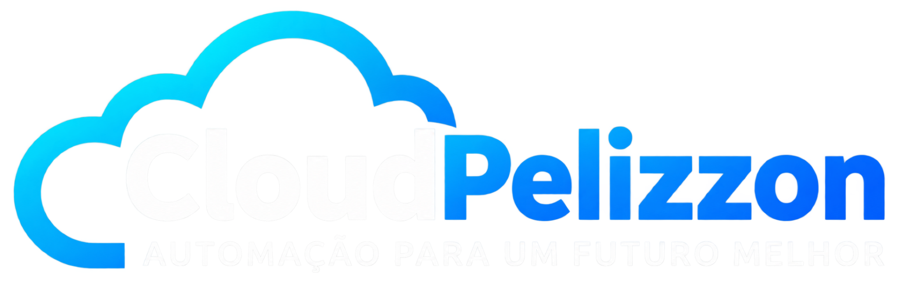

# CloudPelizzon para Home Assistant

Cliente público da CloudPelizzon, com a interface e as imagens originais dos módulos.

O cliente conecta o Home Assistant aos serviços CloudPelizzon. Durante o trial, os motores comerciais executam nos servidores privados; este repositório contém a interface, os transportes e os adaptadores públicos. As chaves privadas da instalação permanecem no Home Assistant.

O teste gratuito tem duração de sete dias por módulo, com confirmação explícita e identidade previamente aprovada. Consultar o status, reinstalar ou parear novamente não reinicia um teste existente. Trial e licença paga são autorizações distintas.

Esta árvore está em homologação. A execução persistente de Automações, a execução segura de Segurança e os fluxos de licença paga/atualização ainda exigem integração e aceite. Não há release estável ou recomendação de instalação em produção nesta etapa. A publicação do código não representa a conclusão dessas funções.

[Site CloudPelizzon](https://cloudpelizzon.com.br) · [Documentação](https://documentacao.cloudpelizzon.com.br) · [Portal do Cliente](https://cliente.cloudpelizzon.com.br)
